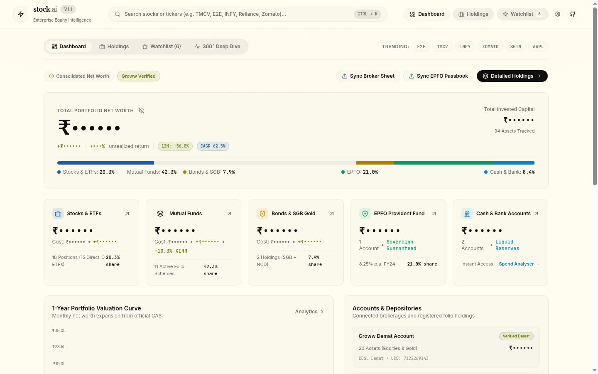
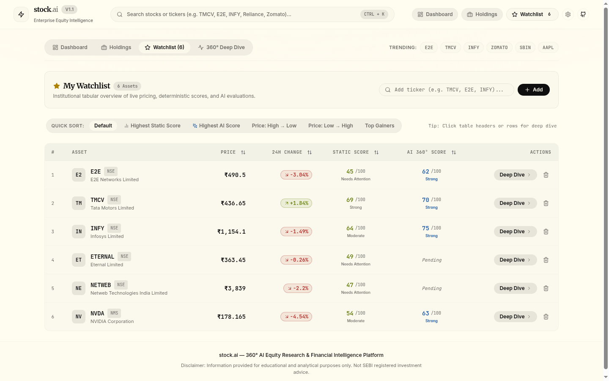
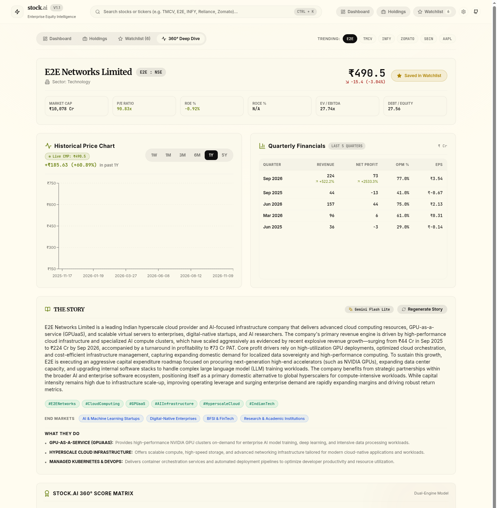
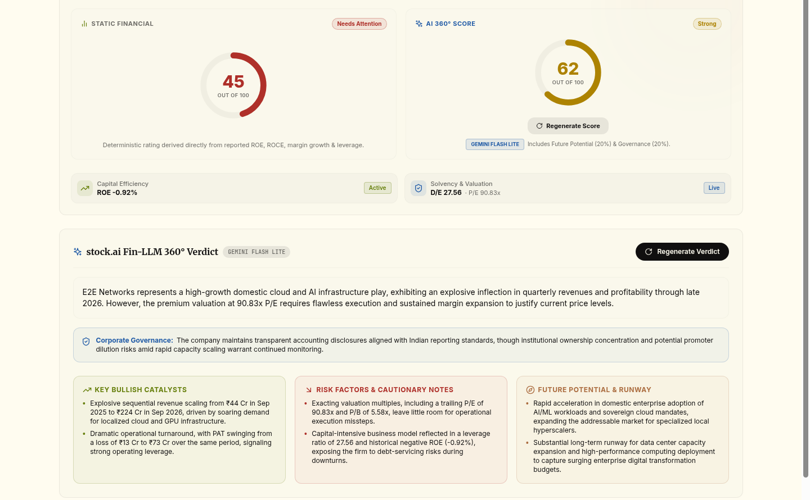

# stock.ai — 360° AI Equity Research & Financial Intelligence Platform

[](https://opensource.org/licenses/MIT)
[](https://nodejs.org/)
[](https://react.dev/)
[](https://vitejs.dev/)
[](https://tailwindcss.com/)
[](https://sqlite.org/)
[](https://aistudio.google.com/)

**stock.ai** is an institutional-grade equity analysis, portfolio intelligence, and wealth management platform built for Indian and global equities (NSE, BSE, and US exchanges). It unifies real-time market data from Yahoo Finance, verified quarterly financial statements from Screener.in, deterministic quantitative ratings, offline statement parsing (CDSL/NSDL e-CAS, broker spreadsheets, EPFO passbooks, bank statements), automated spend intelligence, and multi-pillar qualitative research synthesized by **Google Gemini** with a resilient multi-model fallback pipeline.

---

## 📸 Screenshots & Visual Walkthrough

### 1. Multi-Asset Portfolio Dashboard (Wealthfolio Design System)
Consolidated net worth overview across all asset classes with privacy masking (`••••••`), asset allocation ribbon, historical trajectory, and connected account rollups.



- **One-Tap Privacy Mode**: Toggle the privacy eye icon (`Eye` / `EyeOff`) to instantly mask all balance figures across the entire dashboard.
- **5-Asset Class Architecture**: Real-time aggregation across Direct Stocks & ETFs, Mutual Funds (with XIRR), Sovereign Gold Bonds (SGB), EPFO Provident Fund, and Liquid Bank Accounts.
- **Live CMP Quote Refresh**: Re-evaluates live market valuations and daily returns against Yahoo Finance with one click.

---

### 2. Institutional Watchlist Table
High-density tabular screening monitoring saved assets, real-time market quotes, deterministic scores, and AI evaluations.



- **One-Click Sorting**: Sort instantly by Highest Static Score, Highest AI Score, Price (High $\rightarrow$ Low, Low $\rightarrow$ High), or Top Gainers.
- **Side-by-Side Score Badges**: Compare pure quantitative ratings alongside qualitative AI evaluations.
- **Fast Quick-Add**: Add any ticker with live validation and auto-resolution.

---

### 3. Compact 360° Deep Dive: Side-by-Side Chart, Financials & "The Story"
Compact layout featuring a real-time historical chart, descending chronological quarterly financials table (latest records on top), and the Fin-LLM synthesized business breakdown.



- **Side-by-Side Layout**: Responsive 2-column grid pairing the interactive historical chart with the 8-quarter chronological financial table.
- **Live CMP Anchor**: Chart automatically pins the latest candle to the real-time CMP price with a live pulsing indicator badge.
- **Latest Quarters on Top**: Chronological 8-quarter financial table sorted descending so the latest quarter displays on row #1.
- **"THE STORY" Section**:
  - **Institutional Business Narrative**: Deep synthesis answering core revenue drivers, GPU cluster economics, non-cash depreciation dynamics, and capex runways.
  - **Theme Hashtags**: Color-coded technology and moat tags (`#GPUCloud`, `#SovereignAI`, `#NVIDIA`, `#AIInfrastructure`).
  - **End Markets**: Target customer segments (`Sovereign AI company`, `International customer`, `Domestic market`).
  - **What They Do**: Structured operational capabilities with bold titles and quantitative metrics.

---

### 4. Dual 360° Score Matrix & Fin-LLM Research Thesis
Decoupled quantitative evaluation and qualitative research thesis with independent generation and isolated SQLite persistence.



- **Dual 360° Dial Gauges**:
  - **Deterministic Static Financial Score (Left)**: 100% mathematical formula grading Capital Efficiency (25%), Growth Momentum (25%), Solvency (20%), Valuation (20%), and Price Health (10%).
  - **AI 360° Qualitative Score (Right)**: Evaluated by Gemini incorporating Corporate Governance (20%) and Future Potential (20%) with a dedicated **Regenerate Score** button.
- **stock.ai Fin-LLM 360° Verdict**:
  - **Executive Research Thesis**: 2-sentence synthesis of valuation and risk-reward profile with a dedicated **Regenerate Verdict** button.
  - **Corporate Governance Assessment**: Analysis of promoter pledging, institutional alignment, and accounting disclosures.
  - **3-Pillar Research Grid**: Parallel cards for **Key Bullish Catalysts** (Emerald), **Risk Factors & Cautionary Notes** (Rose), and **Future Potential & Runway** (Cyan).

---

## ⚡ Comprehensive Feature List

### 🧠 1. 360° AI & Quantitative Equity Research
- **Deterministic Static Financial Score ($S_{\text{static}}$)**: Pure quantitative formula across 5 weighted pillars: Capital Efficiency & Profitability (25%), Growth Momentum (25%), Solvency & Balance Sheet (20%), Valuation Multiple (20%), and Price Health (10%).
- **Decoupled AI 360° Score**: Evaluates Corporate Governance (20%) and Future Potential & Moat (20%) alongside capital ratios, outputting quality tiers: `Exceptional` ($\ge 80$), `Strong` ($65\text{–}79$), `Moderate` ($50\text{–}64$), and `High Risk` ($< 50$).
- **Fin-LLM Qualitative Research Thesis**: Synthesizes sharp 2-sentence investment theses, corporate governance audits, and 3-column catalyst matrices (Bullish Catalysts, Risk Factors, Secular Runway).
- **AI-Generated "The Story" Section**: Institutional business analysis detailing revenue segmentation, unit economics, depreciation schedules, upcoming capex lines, technology hashtags, target end markets, and operational capabilities.
- **Multi-Model LLM Fallback Pipeline**: Cascades across Google Generative Language models (`gemini-3.5-flash` Interactions $\rightarrow$ `gemini-3.5-flash` $\rightarrow$ `gemini-3.6-flash` $\rightarrow$ `gemini-flash-lite-latest` $\rightarrow$ `gemini-3.8-flash`) with automatic offline mathematical fallback.

### 📈 2. Deep Dive & Real-Time Market Charts
- **Compact Side-by-Side Layout**: Responsive 2-column view pairing the interactive historical chart with the 8-quarter financial table.
- **Direct `v8/finance/chart` Engine**: Live market prices extracted via Yahoo Finance's direct chart endpoint, eliminating deprecated API errors.
- **Live CMP Anchor**: Pins the latest candle dynamically to real-time market CMP with a pulsing badge and live range change calculation.
- **Descending Chronological Financials**: Shows the most recent 8 quarterly results with latest quarters on top (row #1), complete with YoY % growth and OPM %.
- **Corporate Restructuring Normalization**: Transparently resolves demerged and rebranded tickers (e.g. `TATAMOTORS` $\rightarrow$ `TMCV`, `ZOMATO` $\rightarrow$ `ETERNAL`).

### 💼 3. Wealthfolio Multi-Asset Portfolio Management
- **Unified Net Worth Aggregation**: Combines 5 asset classes: Direct Stocks & ETFs, Mutual Funds, Sovereign Gold Bonds (SGB), EPFO Provident Fund, and Liquid Bank Accounts.
- **Interactive Privacy Mode**: One-tap toggle (`Eye` / `EyeOff`) masks all balance figures as `••••••` for screen sharing and privacy.
- **On-Demand Live CMP Quote Refresh**: One-click re-evaluation of portfolio market values, unrealized gains, and 1D returns via `/api/portfolio/refresh-quotes`.
- **Performance Strip & 12M Trajectory**: Displays 1-Year valuation growth curve, CAGR, best/worst month indicators, and connected account rollups.

### 📑 4. Statement Ingestion & Broker Data Fusion
- **CDSL & NSDL e-CAS PDF Parsing**: Extracts equities, mutual funds, and SGBs with automatic password casing permutation unlocking.
- **Broker Spreadsheet Ingestion**: Supports Groww, Zerodha, Upstox, and Coin XLSX/CSV statements, fusing purchase prices and true cost basis without clearing existing holdings.
- **Scheme-Level XIRR Tracking**: Computes accurate portfolio-level and scheme-level XIRR returns for mutual fund folios.
- **EPFO Multi-Passbook Management**: Ingests single or multiple EPFO member passbook PDFs, consolidating Employee Share (EE), Employer Share (ER), Pension Fund (EPS), and monthly contribution ledgers.

---

## 💳 Bank Statement Spend Analyser & Spend Intelligence Engine

**stock.ai** includes an offline financial intelligence engine that transforms raw bank account statement PDFs into classified spending analytics and budget archetypes:

```
Bank Statement PDF (HDFC / SCB)
   │
   ▼
[ Python Layout-Aware Parser (bank_parser.py) ]
   ├── Balance delta verification: Δ = round(balance - prev_balance, 2)
   ├── Multi-line content stream grouping (pypdfium2 / pdftotext)
   └── Narration scrubbing & merchant extraction
   │
   ▼
[ Statement Classification Engine (spendCategorizer.js) ]
   ├── 8-Bucket Spend Taxonomy Classification
   ├── Aliasing rules (e.g. Groww, Kuvera, HDFC CC, Swiggy, Midtown Foods)
   └── 50/30/20 Financial Archetype Synthesis (Needs, Wants, Wealth, Transfers)
   │
   ▼
[ Interactive Spend Analyser UI (SpendAnalyser.jsx) ]
   ├── 4-Card Hero KPI Strip: Total Outflows, Pure Living Expenses, Top Bucket, Daily Burn Rate
   ├── Category Donut Breakdown & Daily Spending Spikes Bar Chart
   ├── 50/30/20 Budget Lens with proportional progress bars
   ├── Top Frequent Payees with transaction counts and ticket sizes
   └── Filterable, searchable Categorized Outflow Ledger with CR/DR filters
```

### 🏷️ 8-Bucket Spending Taxonomy
1. **Investments & Wealth** (`#10b981`): Groww, Kuvera, Zerodha, mutual fund SIPs, Demat funding, and capital deposits.
2. **Credit Card & Loans** (`#8b5cf6`): HDFC Credit Card bill, BillDesk, loan repayments, and EMI debits.
3. **Food & Dining** (`#f59e0b`): Restaurants, cafes, Midtown Foods, Swiggy, Zomato, and dining outlets.
4. **Utilities & Housing** (`#06b6d4`): Electricity bills, broadband, maintenance, rent, and utility providers.
5. **Personal Transfers** (`#3b82f6`): Inter-account transfers, family remittances, and direct peer transfers.
6. **Travel & Commute** (`#f43f5e`): Fuel stations, Uber, Ola, Metro recharges, and airlines.
7. **Shopping & Services** (`#64748b`): Amazon, Flipkart, retail merchants, apparel, and subscriptions.
8. **Other / Miscellaneous** (`#94a3b8`): Uncategorized transactions and miscellaneous expenses.

### 🎯 50/30/20 Budget Archetype & Burn Rate
- **Pure Living Expenses**: Automatically separates wealth-building investments from living expenses to calculate true monthly operational burn.
- **Daily Expense Velocity**: Computes average daily burn rate across the statement period.
- **Budget Distribution**: Evaluates allocation across **Needs** (Utilities, EMIs, essentials), **Wants** (Dining, Shopping, Entertainment), and **Investments** (Equity, MFs, Gold).

---

## 🔒 Security & Privacy Architecture

- **Offline-First Storage**: All portfolio holdings, bank balances, passbooks, and SQLite records reside locally on your machine in `equisense.db` (`journal_mode = WAL`).
- **Zero-Leak Temporary Storage**: Uploaded statement PDFs and spreadsheets are automatically unlinked (`fs.unlink`) immediately after parsing.
- **Safe Command & Query Execution**:
  - Python parsers run via `execFileAsync` with parameterized argument arrays (no shell spawning).
  - All database operations use prepared statements with parameterized `@parameter` bindings.
- **In-App Key Management**: Google AI Studio keys are entered via the UI, masked, and persisted locally to `.env`.

---

## 🛠️ Tech Stack

| Layer | Technology |
|---|---|
| **Frontend** | React 18, Vite 5.4, Tailwind CSS 3.4, Lucide React, Recharts |
| **Backend** | Node.js, Express 5, Axios, Cheerio, Multer |
| **Database** | SQLite (`better-sqlite3` in WAL mode) |
| **Data Sources** | Yahoo Finance API (`v8/finance/chart`), Screener.in Web Scraper |
| **Statement Parsers** | Python 3.12, `casparser`, `pypdfium2`, `openpyxl`, `poppler-utils` |
| **AI Engine** | Google Gemini (`gemini-3.5-flash`, `gemini-3.6-flash`, `gemini-flash-lite`, `gemini-3.8-flash`) |
| **Design Language** | Steph Ango's Flexoki Paper Cream Palette (`#fffcf0` / `#100f0f`) |

---

## 🚀 Getting Started

### Prerequisites
- Node.js v18.0.0 or higher
- Python 3.10+ (for statement parsers)
- npm or yarn

### 1. Clone the Repository
```bash
git clone https://github.com/Escanor1996/stock.ai.git
cd stock.ai
```

### 2. Install Dependencies
```bash
npm install
```

### 3. Environment Configuration
Create a `.env` file in the root directory (or enter your key via the in-app Settings modal):
```env
PORT=3001
GEMINI_API_KEY=your_google_ai_studio_api_key_here
```
> **Note**: If `GEMINI_API_KEY` is omitted, the app will automatically run offline using the built-in `stock.ai Algorithm` heuristic engine.

### 4. Run Development Servers
Start both the Express backend (port 3001) and Vite frontend (port 3000) concurrently:
```bash
npm run dev
```

Open your browser and navigate to **`http://localhost:3000`**.

---

## 📡 API Endpoints

| Method | Endpoint | Description |
|---|---|---|
| `GET` | `/api/stock/:ticker` | Returns unified stock profile (quote, fundamentals, quarters, and saved AI analysis). |
| `GET` | `/api/stock/:ticker/history?range=1y` | Returns historical price series anchored to live CMP (`1w`, `1m`, `3m`, `6m`, `1y`, `5y`). |
| `GET` | `/api/stock/:ticker/score?refresh=true` | Triggers independent AI 360° quantitative scoring across the 6 pillars. |
| `GET` | `/api/stock/:ticker/verdict?refresh=true` | Synthesizes independent Fin-LLM qualitative research thesis & 3-pillar catalysts. |
| `GET` | `/api/stock/:ticker/story?refresh=true` | Generates "The Story" business breakdown with hashtags, end markets, and capabilities. |
| `GET` | `/api/search?q=:query` | Real-time ticker and company lookup. |
| `POST` | `/api/portfolio/refresh-quotes` | Refreshes all portfolio stocks and ETFs with latest live CMP and recalculates valuation. |
| `POST` | `/api/portfolio/parse` | Ingests and parses official CDSL/NSDL e-CAS PDF statements. |
| `POST` | `/api/portfolio/broker-statement` | Parses Groww/Zerodha/Upstox XLSX/CSV statements with cost basis and XIRR. |
| `POST` | `/api/portfolio/epfo-passbook` | Parses single or multiple EPFO member passbook PDFs. |
| `POST` | `/api/portfolio/bank-statement` | Ingests HDFC or Standard Chartered bank statements with spend intelligence. |
| `GET` | `/api/settings` | Returns active AI engine status and masked API key. |
| `POST` | `/api/settings` | Saves new Gemini API key to local `.env`. |
| `POST` | `/api/settings/test` | Live endpoint validation against Google AI Studio. |

---

## 📄 License

This project is licensed under the **MIT License** — see the [LICENSE](./LICENSE) file for details.

```
MIT License
Copyright (c) 2026 Arka Chakraborty
```

---

## ⚖️ Disclaimer

Information provided by **stock.ai** is strictly for educational and analytical purposes only. It does not constitute investment advice, financial endorsement, or a recommendation to buy or sell securities. The platform is not a SEBI-registered investment advisor. Always conduct your own research before making financial decisions.
